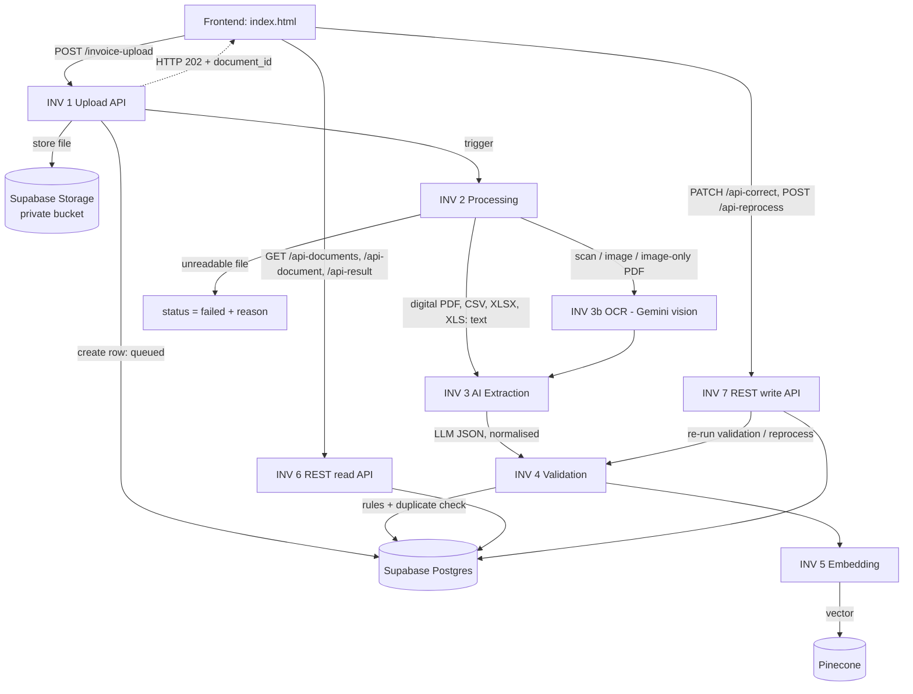
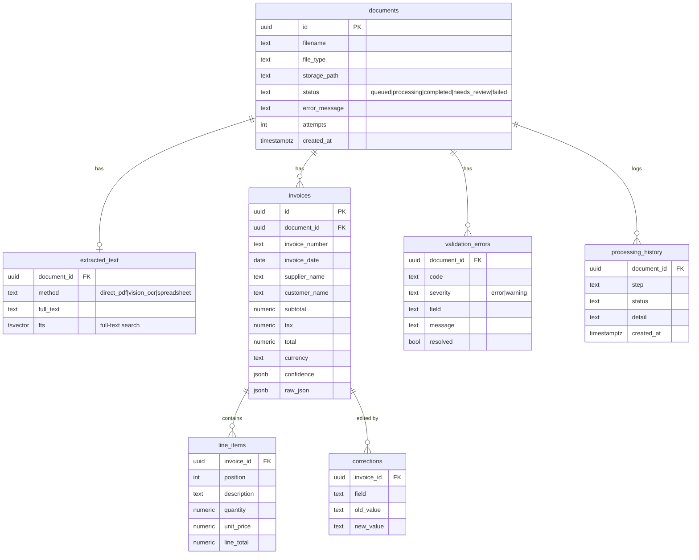

# AI Document Intelligence System

Upload invoices (PDF, JPG, PNG, TIFF, XLSX, XLS, CSV). The system reads them (text extraction or vision OCR), extracts structured invoice data with an LLM **without inventing missing values**, validates the numbers, flags records for manual review, lets a person correct values, and stores everything for keyword search.

Built as the assessment task for Care Guide (AI/Automation Engineer). It is a **scoped MVP** built with low-code tools (n8n, Supabase) plus LLM APIs, and it was built **with heavy AI assistance**. See [AI assistance disclosure](#12-ai-assistance-disclosure) and [Known limitations](#10-known-limitations-read-this). Nothing here claims more than was measured.

| | |
|---|---|
| Live frontend | https://invoiceheler.netlify.app/#/ |
| Demo video | https://drive.google.com/file/d/116qhpsN-MzzzYBZhnJguAahtQqPsCSAH/view?usp=sharing |
| Portfolio | https://riyadhossain.vercel.app |
| Evaluation report | [`results/evaluation_report.md`](results/evaluation_report.md) |

---

## 1. What it does

- Accepts multiple files; each is processed in the background (the upload call returns immediately with status `queued`).
- Digital PDFs: text is read directly. Scans, images and image-only PDFs: read by a vision model (Gemini). CSV/XLSX/XLS: parsed as tables.
- An LLM returns invoice number, date, supplier, customer, subtotal, tax, total, currency, line items and a confidence score per field. Unknown values are returned as `null`, never guessed.
- Validation rules check missing fields, bad numbers, arithmetic consistency and duplicates, and set the final status: `completed` or `needs_review` (or `failed` if the file could not be read).
- A web page shows progress, results, validation issues, lets you correct fields, reprocess failed files and search past documents.

## 2. Architecture



**Status flow:** `queued` → `processing` → `completed` | `needs_review` | `failed`. Every step writes a row to `processing_history`, which the UI uses to show progress.

### Workflows

| File | Webhook path | Purpose |
|---|---|---|
| `INV_1_Upload_API.json` | `POST /invoice-upload` | Checks API key and file type, stores the file, creates the document row, replies 202, triggers INV 2 |
| `INV_2_Processing.json` | `POST /invoice-process` | Downloads the file, routes by type, extracts text (PDF/CSV/XLSX/XLS), decides if OCR is needed |
| `INV_3b_OCR.json` | `POST /invoice-ocr` | Sends images / scanned PDFs to Gemini vision, saves the transcription (unreadable parts marked `[illegible]`) |
| `INV_3_AI_Extraction.json` | `POST /invoice-extract` | LLM extraction (temperature 0, strict "never invent" prompt), cleaning of numbers/dates/currency, saves invoice + line items |
| `INV_4_Validation.json` | `POST /invoice-validate` | Validation rules, duplicate detection, final status |
| `INV_5_Embedding.json` | `POST /invoice-embed` | Creates an embedding of the document summary + text and upserts it into Pinecone |
| `INV_6_REST_API_read.json` | `GET /api-documents`, `/api-document`, `/api-result` | Read endpoints used by the UI |
| `INV_7_REST_API_write.json` | `PATCH /api-correct`, `POST /api-reprocess` | Manual correction and reprocessing |

## 3. Design decisions (and why they differ from the suggested stack)

| Suggested | Used instead | Reason |
|---|---|---|
| NestJS / Node backend | **n8n workflows with webhooks** as the REST API | Fast to build, visual, easy to explain; the author's strongest tool |
| Redis / BullMQ queue | Upload replies **202** immediately, then triggers the next workflow over HTTP; status lives in the database | Real asynchronous processing with no extra infrastructure. Trade-off: no automatic retry queue (see limitations) |
| Python OCR libraries | **Gemini vision** (`gemini-2.5-flash`) | Reads poor-quality scans and returns text in one step; instructed to write `[illegible]` instead of guessing digits |
| LLM | `gpt-4o-mini` (via n8n credits) for extraction, temperature 0 | Cheap and good enough for structured extraction |
| PostgreSQL | **Supabase Postgres + Storage** | Hosted, free tier, built-in full-text search |
| Vector DB | **Pinecone** (`gemini-embedding-001`, 768 dimensions) | Already used in a previous project |
| React / Next.js | A **single-file vanilla JavaScript page** (`frontend/index.html`) | Simple, no build step. **This does not follow the React requirement.** |
| Semantic search | Documents are **embedded and indexed**, but there is **no query endpoint or UI yet** | See limitations |

## 4. Repository layout

```
workflows/     exported n8n workflows (secrets removed)
sql/schema.sql database schema
frontend/      index.html
tests/         pytest integration tests (conftest.py, test_api.py)
evaluation/    evaluate.py and the labeled dataset generator
results/       evaluation outputs (report, CSV, JSON)
README.md      this file
PROMPTS.md     runtime prompts and AI-assistance notes
```

## 5. Database schema

Full SQL: [`sql/schema.sql`](sql/schema.sql). Overview (key columns only):



`invoices` is deliberately **not** unique on invoice number, so duplicates are stored and then flagged instead of rejected.

## 6. Setup

**You need:** a Supabase project, an n8n instance (n8n Cloud works), a Gemini API key, an OpenAI-compatible LLM credential (or n8n AI credits), a Pinecone index, Python 3.10+ for the tests.

### 6.1 Supabase
1. Create a project. In **SQL Editor**, run `sql/schema.sql`.
2. **Storage → New bucket** named `documents`, set to **private**.
3. Copy the project URL and the **service role key** (Project Settings → API). The service role key goes only into n8n credentials. Never into the frontend or Git.

### 6.2 Pinecone
Create a serverless index with **768 dimensions** and the **cosine** metric. Note its host URL.

### 6.3 n8n credentials
Create these in n8n (**Credentials → New**):

| Credential | Type | Used by |
|---|---|---|
| Supabase | Supabase API (URL + service role key) | all workflows |
| Gemini | Header Auth, name `x-goog-api-key`, value = your Gemini key | INV 3b, INV 5 |
| Pinecone | Header Auth, name `Api-Key`, value = your Pinecone key | INV 5 |
| LLM | OpenAI (or the n8n AI credits) | INV 3 |
| API Key Header | Header Auth, name `apikey`, value = a long random string | INV 6, INV 7 |

### 6.4 Import the workflows
1. Import all eight files from `workflows/` (Workflows → Import from file).
2. Open each node that shows a red credential warning and pick your own credential. Imported credential IDs belong to the original instance.
3. **Find and replace these hard-coded values** in every workflow (Supabase URL and n8n host): `cqktvuidwccrynrdtstn.supabase.co` → your Supabase host; `assignment02.app.n8n.cloud` → your n8n host. Also set your Pinecone host in INV 5 ("Pinecone Upsert").
4. In **INV 1 → "Validate & Prepare"** (Code node) replace `CHANGE_ME_API_KEY` with your own secret. This is the key the upload endpoint checks.
5. Check that the "trigger the next stage" HTTP nodes point to **production** webhook URLs (`/webhook/...`, not `/webhook-test/...`) of the right workflow: INV 1→2, 2→3 and 2→3b, 3b→3, 3→4, 4→5.
6. **Activate all eight workflows.**

### 6.5 Frontend
Open `frontend/index.html`. Set the `API` constant near the top of the script to `https://<your-n8n-host>/webhook`. Open the file in a browser (or deploy the single file to Vercel/Netlify), click **API key** and paste the key. It is stored only in that browser's `localStorage`.

### 6.6 Quick check
```powershell
curl.exe -X POST "https://<your-n8n-host>/webhook/invoice-upload" -H "apikey: <your-key>" -F "file=@digital_01.pdf"
# expected: {"document_id":"...","filename":"digital_01.pdf","status":"queued"}  (HTTP 202)
```

## 7. API reference

All endpoints need the header `apikey: <key>`. Wrong or missing key: `401` (upload) or `403` (others).

| Method & path | Body / query | Success | Errors |
|---|---|---|---|
| `POST /invoice-upload` | multipart field `file` | `202 {document_id, filename, status:"queued"}` | `400` unsupported type / no file, `401` bad key |
| `GET /api-documents` | `q`, `supplier`, `status`, `from`, `to`, `limit` | `200 {count, data:[...]}` | |
| `GET /api-document?id=` | | `200` status, attempts, `processing_history` | `404` |
| `GET /api-result?id=` | | `200` document + `invoices[]` (with `line_items`) + `validation_errors[]` | `404` |
| `PATCH /api-correct` | `{invoice_id, fields:{...}}` | `200 {corrected_fields}`; writes `corrections`, re-runs validation | `400` invalid value/date/no fields, `404` |
| `POST /api-reprocess` | `{document_id}` | `202 {status:"queued"}` (resets status, re-runs the pipeline) | `404` |

Keyword search (`q`) uses Postgres full-text search over the extracted text. Supplier and date filters use the structured invoice fields.

## 8. Validation rules

| Rule | Severity |
|---|---|
| `NO_EXTRACTION`: nothing could be extracted | error |
| `MISSING_FIELD`: invoice number, date, supplier, customer, total (and others) missing | error / warning |
| `NOT_A_NUMBER`, `NEGATIVE_VALUE`, `ZERO_TOTAL` | error |
| `TOTAL_MISMATCH`: subtotal + tax ≠ total (tolerance 0.01) | error |
| `LINE_TOTAL_MISMATCH`: quantity × unit price ≠ line total | error |
| `LINE_SUM_MISMATCH`: sum of line totals ≠ subtotal | error |
| `DUPLICATE_INVOICE`: same supplier and invoice number already stored | error |
| `LOW_CONFIDENCE`: model confidence below threshold | warning |

Any error-level issue sets the document to `needs_review`. The system reports what the document says; it never "fixes" arithmetic itself.

## 9. Testing and evaluation

### Automated tests
`tests/` holds **31 pytest integration tests** that call the **live** n8n API (black-box). They are integration tests, not unit tests. They cover security (missing/wrong key), upload validation, the PDF/CSV/XLSX pipeline, corrupt-file handling, the read API (list, filter, search, hostile input, 404s), manual correction (valid and invalid), and reprocessing.

```powershell
cd tests
pip install -r requirements.txt
$env:DI_API_KEY = "<your-key>"
$env:DI_DATASET_DIR = "<path to the dataset folder>"
py -m pytest -v --tb=short --junitxml=test_results.xml
```
Latest result (2026-11-04): **31 passed, 0 failed, 0 skipped in 56 s** (`test_results.xml`). The first run had setup errors in the test fixtures (`conftest.py`). They were fixed with AI help (Gemini); the test assertions were not changed. These tests check that the API and pipeline behave correctly; they do not measure extraction accuracy (that is the evaluation below).

### Evaluation on the labeled dataset
`evaluation/evaluate.py` uploads all 32 labeled files (13 digital PDFs, 6 scans, 2 very poor images, 3 multi-sheet XLSX, 2 CSV, a 3-page PDF, 4 corrupt files, 4 planted-error invoices, 1 duplicate pair), compares the output with `labels.json`, and writes `results/evaluation_report.md`, `evaluation_per_file.csv`, `evaluation_results.json`. Empty the database first, otherwise earlier uploads trigger false duplicate flags.

```powershell
py evaluate.py --dataset "<dataset folder>" --concurrency 3
```

**Measured results**: one run, 2026-11-04, concurrency 3, empty database, 32 files, 158 s wall-clock. Numbers are taken from `results/evaluation_results.json`; nothing was edited. The run was **not repeated**, so these are single-run figures.

| Metric | Result |
|---|---|
| Field-level accuracy (28 files that should process, 8 header fields each) | **81.2%** (182/224) |
| Field accuracy on the 24 files that actually processed | 94.8% (182/192) |
| Fully correct documents | 22/28 (78.6%) |
| Success / failure rate (28 files expected to process) | 85.7% / 14.3% |
| Final status as expected | 27/32 (84.4%) |
| Corrupt files ended as `failed` with a clear message | 4/4 |
| Validation flags detected | 4/5 |
| False error flags on clean documents | 0/23 |
| Line items: recall / precision | 87.7% / 99.3% (143 matched of 163 true, 144 extracted) |
| "Invented" values (value returned where the document has none) | 0 |
| Processing time mean / median / p90 / max | 11.6 / 8.1 / 20.8 / 39.4 s |

Accuracy by file type:

| Type | Files | Field accuracy | Fully correct |
|---|---|---|---|
| Digital PDF | 13 | 100% | 13/13 |
| CSV | 2 | 100% | 2/2 |
| Multi-page PDF (70 line items) | 1 | 100% | 1/1 (70/70 lines) |
| XLSX | 3 | 66.7% | 2/3 |
| Scanned images | 6 | 66.7% | 4/6 |
| Scanned PDF | 1 | 0% | 0/1 |
| Poor quality images | 2 | 37.5% | 0/2 |

**What went wrong (all of it).**

1. **Four OCR failures.** `scan_04.png`, `scan_06.pdf`, `poor_quality_02.jpg` and `dup_resend.jpg` ended as `failed`. In all four, the stored error is an error returned by the Gemini API: three show a rate-limit message ("try spacing your requests out") and one shows a `503` "high demand" error. These are infrastructure failures at concurrency 3, not extraction mistakes. The files were marked `failed` and can be retried with `/api-reprocess`, but I did **not** re-run them, so I cannot say they would now succeed. The OCR node already retries once (2 tries, 2 s wait), which was not enough. Because `dup_resend.jpg` failed, the one expected `DUPLICATE_INVOICE` flag was **not produced**, so duplicate detection was **not verified end-to-end** on the image/PDF pair.
2. **A misread blurry image that was not flagged.** `poor_quality_01.jpg` came back with a wrong invoice number (`INV-2020-1013` instead of `INV-2026-1015`) and a wrong date (`2020-04-12` instead of `2026-04-15`) and ended as `completed`. It should have been `needs_review`. So "0 invented values" only means the system never filled in something that was absent; it can still **misread digits** on bad images, and the confidence/validation checks did not catch it here.
3. **An empty XLSX result marked `completed`.** `sheet_03.xlsx` returned no header fields and no line items (0 of 8 fields, 0 of 3 lines), yet its final status was `completed`. The cause was not investigated. An empty extraction should be flagged for review, so this is a gap in the pipeline.

**Limits of the evaluation.** 32 files, synthetically generated, so real-world messy documents will do worse. Strict matching: a field counts only if it equals the label (numbers within 0.01); a value returned where the label says "absent" counts as wrong. Failed files count as fully wrong. Time is measured by the client (polling every 2 s, about ±2 s resolution) and excludes the embedding step.

## 10. Known limitations (read this)

- **No semantic-search query.** Embeddings are created and stored in Pinecone (INV 5) but no endpoint or UI queries them yet. Search in the UI is keyword/filter based.
- **Frontend is not React/Next.js**; it is one vanilla-JS file.
- **OCR reliability.** Gemini rate limits and overload caused 4 failures in the evaluation (section 9). Use a paid tier, lower concurrency, or longer retry back-off. The free tier may use submitted data for training: do not process real client documents on it.
- **Misread digits on poor images** are not reliably caught (see `poor_quality_01.jpg`).
- **Empty extractions can end as `completed`** (see `sheet_03.xlsx`). Not yet diagnosed or fixed.
- **Duplicate detection** is by supplier + invoice number, not by file hash, and was not verified end-to-end in the evaluation because the duplicate image failed OCR.
- **Large files.** PDFs up to ~1000 pages were **not tested**. OCR sends the whole file to Gemini in one request, so very large scans will likely fail. Extracted text is capped at 60,000 characters before the LLM call. The frontend limits uploads to 20 MB (client-side only).
- **Excel handling.** Only the first sheet and a sheet named `Line Items` are read. `.xls` is supported in the workflow but was **not tested** (no sample file).
- **One invoice per file.** Files containing several invoices are not split.
- **Queueing.** There is no job queue with automatic retries. If a step fails the document is marked `failed` and can be reprocessed manually (`/api-reprocess`).
- **File-type check** is by extension, not by file content.
- **Evaluation** is a single run on synthetic data (section 9).
- **n8n Cloud trial** runs for 14 days; the workflows are exported as JSON so they can be re-imported.

## 11. Security notes

- All read/write endpoints need an API key header. The key is stored in the browser's `localStorage` by the frontend, so anyone using the page holds it. This is a **demo-level** control. A real product needs per-user login.
- **Inconsistency:** INV 6/7 check the key with an n8n Header Auth credential, while INV 1 compares it inside a Code node. Replace `CHANGE_ME_API_KEY` with your own value and never commit the real key.
- The Supabase **service role key** exists only inside n8n credentials. It is not in the frontend or in the exported workflows.
- **Row Level Security is disabled** on the tables; only n8n (with the service key) accesses them. Do not expose the Supabase anon key to these tables without enabling RLS policies first.
- The internal workflow webhooks (`invoice-process`, `-ocr`, `-extract`, `-validate`, `-embed`) have **no authentication**. Anyone who learns the URL can trigger them with a document ID. Add a shared-secret header before production use.
- The upload webhook allows any browser origin (`allowedOrigins: *`).
- The storage bucket is private. The frontend escapes all values it renders.
- Exported workflows must not contain real keys: check before committing.

## 12. AI assistance disclosure

This project was built with substantial help from AI tools, as the assessment allows and asks to be disclosed.

- **Claude (Anthropic)** generated most of the artifacts: the n8n workflow JSON files, the SQL schema, the synthetic dataset generator, the pytest suite, the evaluation script, the frontend page, and this README. It was also used to diagnose problems (for example, a wrong workflow URL that stopped the pipeline at validation).
- **Gemini** was used to fix errors in the test fixtures and as the OCR/embedding model inside the product.
- **The author (Riyad Hossain)** chose the architecture and scope, set up the accounts and credentials, imported and connected the workflows, ran every test and evaluation, debugged failures with screenshots, and decided what to report. The author is self-taught in AI automation (n8n, Vapi, Retell, Airtable, Pinecone) and does not write code professionally.
- Prompts used inside the system are in [`PROMPTS.md`](PROMPTS.md).

## 13. Future work

1. Fix OCR reliability: longer retry back-off, lower concurrency, automatic re-queue of failed OCR jobs.
2. Flag empty or low-confidence extractions as `needs_review` (the `sheet_03.xlsx` and `poor_quality_01.jpg` cases), and re-run the evaluation.
3. Semantic-search endpoint (query embedding → Pinecone → merge with Postgres rows) and UI.
4. Rebuild the frontend in React/Next.js with real user authentication.
5. Shared-secret check on internal webhooks; page-by-page OCR for very large scanned PDFs; read all Excel sheets; file-hash duplicate detection; multi-invoice file splitting.
